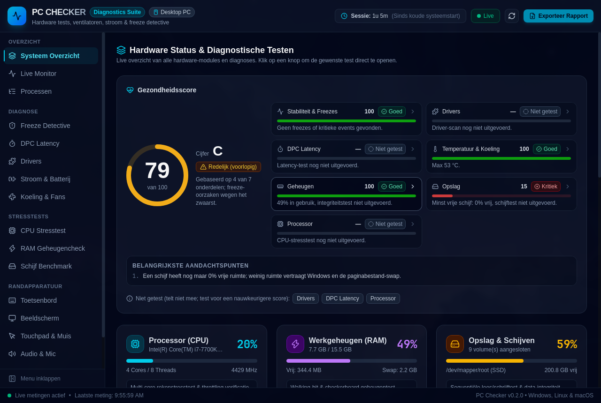
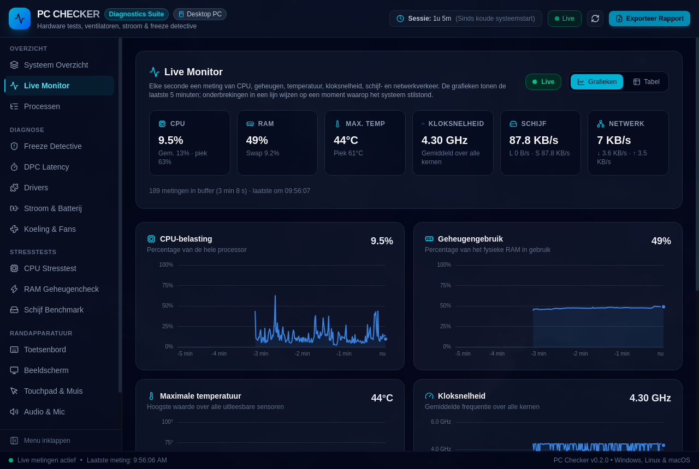
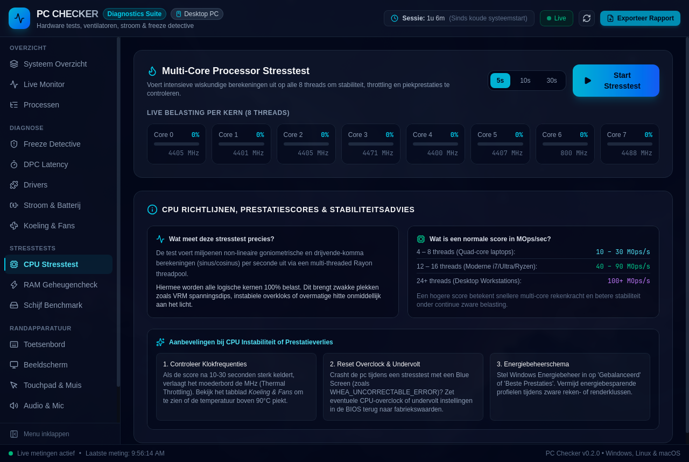

# PC Checker

**Find out why your PC freezes, stutters or crashes, then fix it.** PC Checker is a fast, open-source desktop app for hardware diagnostics, freeze detection, DPC latency analysis, stress testing and live monitoring.

[](https://github.com/lucius02/pc-checker/actions/workflows/ci.yml)
[](https://github.com/lucius02/pc-checker/releases/latest)
[](#license)
[](https://github.com/lucius02/pc-checker/issues?q=is%3Aissue+is%3Aopen+label%3A%22good+first+issue%22)

Built with **Tauri v2**, **Rust** (native hardware engine), **React 19** and **Tailwind CSS**. Available in English and Dutch. 🇳🇱 [Nederlandse README](README.nl.md)



| Live Monitor | CPU stress test |
|---|---|
|  |  |

## Download

Grab the installer for your platform from the [latest release](https://github.com/lucius02/pc-checker/releases/latest). The app updates itself when a new version is out.

| Platform | Support |
|---|---|
| **Windows 10/11** | Full: every module (WMI, Event Log, powercfg, Storage Reliability Counters, DPC counters, ETW). |
| **Linux** | Partial: system overview (sysfs/DMI, `lspci`), temperatures and fans (hwmon), power and battery (`/sys/class/power_supply`), freeze scan via `journalctl -k`, stress tests, live monitor. No driver check, DPC latency counters or SMART yet. |
| **macOS** | Basic: system overview, temperatures (sysinfo), stress tests and live monitor. |

Linux and macOS support is where help is most welcome. See [Contributing](#contributing).

---

## Features

### 🛡️ Freeze Detective and Watchdog
* **Background watchdog:** continuously watches kernel thread scheduling. When the OS stalls for more than 1.2 seconds, it records the exact time and duration of the freeze.
* **Event log scanner** (Windows) for the usual culprits behind desktop freezes:
  * `storahci` event 129 (*Reset to device was issued*): the #1 cause, usually SATA/SSD link power management (ALPM) or a bad data cable.
  * `disk` events 153 / 51 (*I/O retry*): bad sectors or buffer hang-ups.
  * `Display` / `nvlddmkm` / `amdkmdag` event 4101 (*GPU TDR*): the graphics driver stopped responding and Windows reset it.
  * `Microsoft-Windows-WHEA-Logger`: hardware PCIe / CPU bus errors.
  * BugCheck stop codes, Kernel-Power, NTFS and service time-outs.
* **Fix steps per incident:** concrete actions such as disabling SATA LPM, a clean driver reinstall with DDU, or checking cables.
* On Linux the scanner reads `journalctl -k`.

### ⏱️ DPC Latency
* Measures scheduling latency with a high-priority spin loop (max / p99 / mean in µs, histogram) and reads the Windows counters `% DPC Time`, `% Interrupt Time` and `DPCs Queued/sec`.
* **Per-driver DPC/ISR tracing (ETW, admin):** attributes every DPC and interrupt to the driver that ran it, like LatencyMon. It shows the longest and total DPC/ISR time per driver, with a verdict (DPC < 500 µs and ISR < 100 µs is good). It uses its own system-logger session, so it doesn't clash with LatencyMon or Process Explorer.

### 🧩 Driver Check
* Scans every driver via WMI for problem devices (Device Manager error codes), outdated drivers and unsigned drivers.
* Focuses on freeze-sensitive classes (GPU, storage controllers, network, audio, USB, chipset), with advice per driver.

### 🩺 Health Score
* One score (0–100) and a grade (A–F), built from temperature, stability, drivers, DPC latency, storage, memory, CPU and battery.
* Tests you haven't run don't count and show as "Not tested". Critical findings cap the grade.

### 🔥 Stress tests
* **CPU:** a multithreaded floating-point load via `rayon`, with live per-core load and clock speed and a score in MOps/s. Every block is compared bit-for-bit with a precomputed reference, so a CPU that miscalculates under load (unstable overclock or undervolt, overheating) gets caught.
* **RAM:** 14 patterns per pass (checkerboard, walking ones, address-in-address, moving inversions, seeded random). Size is configurable from 256 MB up to 70% of free memory (max 32 GB), running in parallel on all cores. On errors it reports the address, the expected and read values, and the flipped bits.
* **Disk:** sequential read/write speed with **direct I/O** (Windows `FILE_FLAG_NO_BUFFERING`, Linux `O_DIRECT`, macOS `F_NOCACHE`), so you measure the disk, not the OS cache. Each 1 MB block gets a unique pattern, so misplaced or stale blocks are detected too.
* **GPU:** a WebGL2 fragment shader at full resolution with adjustable intensity. It measures FPS (mean and minimum) and detects driver resets (WebGL context lost, similar to a TDR).
* **Burn-in:** CPU + RAM + GPU at once (5 to 60 minutes) with temperature logging and freeze counting. It finds unstable power supplies and overclocks.

### 💽 Disk health (SMART)
* Reads health status, SSD wear, temperature, power-on hours and (un)correctable errors per physical disk via `Get-PhysicalDisk` + `Get-StorageReliabilityCounter`.
* The Good / Warning / Critical verdict feeds into the health score. Some counters need admin rights.

### 📈 Live Monitor and processes
* A background sampler (once per second) feeds live charts for CPU load, RAM, max temperature, clock speed, disk I/O and network traffic. It keeps a 5-minute ring buffer, and gaps in the lines show exactly when the system froze.
* The top processes by CPU, RAM or disk refresh every 2 seconds. **Processes right before a freeze** links each watchdog freeze to the processes that were busiest just before it.

### 🌀 Cooling, ⚡ power and battery
* Real-time temperatures for CPU cores, GPU and drives, plus fan speeds (RPM) via ACPI/WMI and hwmon. It warns about throttling above 90 °C.
* Detects laptop vs. desktop automatically. Laptops get charge level, AC adapter state and battery wear (design vs. full capacity, cycle count) from `powercfg /batteryreport` or sysfs. Missing data shows as "Unknown", never as made-up numbers.
* On desktops: AC line status, the active Windows power plan, and warnings about aggressive disk sleep settings.

### 🖱️ Peripheral tests
* **Keyboard:** detects layout (QWERTY / AZERTY / QWERTZ), ANSI vs. ISO Enter, and laptop / TKL / full-size form factor, and measures N-key rollover and ghosting.
* **Display:** a full-screen dead/stuck pixel test with 8 colours, live refresh-rate measurement, a 256-step gradient and a black-level check.
* **Mouse and touchpad:** a hi-DPI dead-zone scanner, 5-button test, double-click (switch chatter) detector (< 75 ms), drag integrity test and scroll telemetry.
* **Audio, microphone, camera and network** checks.

### 🕓 History, reports and admin mode
* Freezes and health scores are kept across sessions (`history.json`), with freezes per day over 14 days, 7- and 30-day totals, and the score trend.
* Export a **self-contained HTML report** (printable to PDF, light and dark) or **JSON** with all raw data.
* On Windows the app can restart itself as administrator (UAC). That unlocks SMART temperature/wear, ETW driver tracing and real-time priority for the latency test.

---

## Getting started (development)

### Requirements
Node.js 22+, Rust (stable) and the [Tauri prerequisites](https://tauri.app/start/prerequisites/) for your platform.

```bash
npm install
npm run tauri dev
```

### Tests and checks
```bash
npm test            # Vitest
npm run lint        # ESLint
npm run typecheck   # tsc
cargo test --manifest-path src-tauri/Cargo.toml
```

The real ETW trace needs admin rights, so it isn't run by default. Run it from an elevated terminal:
```bash
cargo test --manifest-path src-tauri/Cargo.toml live_etw -- --ignored --nocapture
```

### TypeScript types are generated from Rust
The types in `src/types/generated/` are generated with [ts-rs](https://github.com/Aleph-Alpha/ts-rs) from `src-tauri/src/models.rs` (also on every `cargo test`). After changing a model in Rust, run:
```bash
npm run gen:types
```

### Building an installer
```bash
npm run tauri build
```
Installers end up in `src-tauri/target/release/bundle/`. See [RELEASING.md](RELEASING.md) for releases via GitHub Actions and code signing.

---

## Architecture

| Layer | Location | Role |
|---|---|---|
| Tauri commands | `src-tauri/src/commands.rs` | Every command is `async`, does its work in `spawn_blocking` and returns `Result<T, String>` |
| Diagnostic modules | `src-tauri/src/*.rs` | Blocking, testable implementations per topic (`freeze.rs`, `latency.rs`, `drivers.rs`, …) |
| Process helper | `src-tauri/src/shell.rs` | Hidden PowerShell/cmd processes with time-outs and JSON normalisation |
| Backend i18n | `src-tauri/src/i18n.rs` | The `tr!("Nederlands", "English")` macro for text the backend returns |
| API layer | `src/lib/api.ts` | Typed wrappers around `invoke` |
| UI | `src/components/tabs/` | One React component (and folder) per tab |
| State | `src/store/` | Zustand stores (diagnostics state, notifications) |
| Frontend i18n | `src/i18n/` | NL/EN strings, one file per tab in `tabs/` |

Some design choices worth knowing:
* **The UI never blocks.** Stress tests and WMI queries run on worker threads, so they don't freeze the window or distort the app's own freeze and latency measurements.
* **Native WMI** (`wmi` crate) for frequently polled data instead of a PowerShell process per poll. Heavy queries (ACPI thermal zones, power plans) are cached for 30 seconds.
* **Status codes are Dutch strings** (`"Goed"`, `"Let op"`, `"Kritiek"`, …) because the frontend compares on them. They are translated for display in `src/i18n/status.ts`. (Replacing them with an enum is tracked in [#12](https://github.com/lucius02/pc-checker/issues/12).)
* **Errors are visible:** every command returns `Result<T, String>`, and failures show up as a toast in the UI.

CI (`.github/workflows/ci.yml`) runs on every push and pull request: `tsc`, ESLint, Vitest and a production build for the frontend, plus `cargo fmt --check`, `cargo clippy -D warnings`, `cargo test` and a check that the generated TypeScript types are current (Windows + Linux).

---

## Contributing

Contributions are very welcome, from a typo fix to a new diagnostic module. Good places to start:

* 🏷️ Issues labelled [**good first issue**](https://github.com/lucius02/pc-checker/issues?q=is%3Aissue+is%3Aopen+label%3A%22good+first+issue%22) or [**help wanted**](https://github.com/lucius02/pc-checker/issues?q=is%3Aissue+is%3Aopen+label%3A%22help+wanted%22)
* 🐧 🍎 **Linux and macOS support:** many modules are Windows-only today
* 🌍 **Translations** and English documentation
* 🧪 **Hardware reports:** tell us what PC Checker gets wrong on your machine

Read [CONTRIBUTING.md](CONTRIBUTING.md) to get set up, and ask questions in [Discussions](https://github.com/lucius02/pc-checker/discussions). This project follows the [Code of Conduct](CODE_OF_CONDUCT.md). Please report security issues privately as described in [SECURITY.md](SECURITY.md).

## License

Licensed under either of

* Apache License, Version 2.0 ([LICENSE-APACHE](LICENSE-APACHE))
* MIT license ([LICENSE-MIT](LICENSE-MIT))

at your option.

Unless you explicitly state otherwise, any contribution intentionally submitted for inclusion in the work by you, as defined in the Apache-2.0 license, shall be dual licensed as above, without any additional terms or conditions.
